# Design Chamber

Design canvases, HTML pages and design systems, drawn inside OpenChamber. You ask your own chat agent for a design. It writes plain files to a folder. Design Chamber shows them live, lets you comment on them, version them, check them and export them.

[](LICENSE)
[](#install)

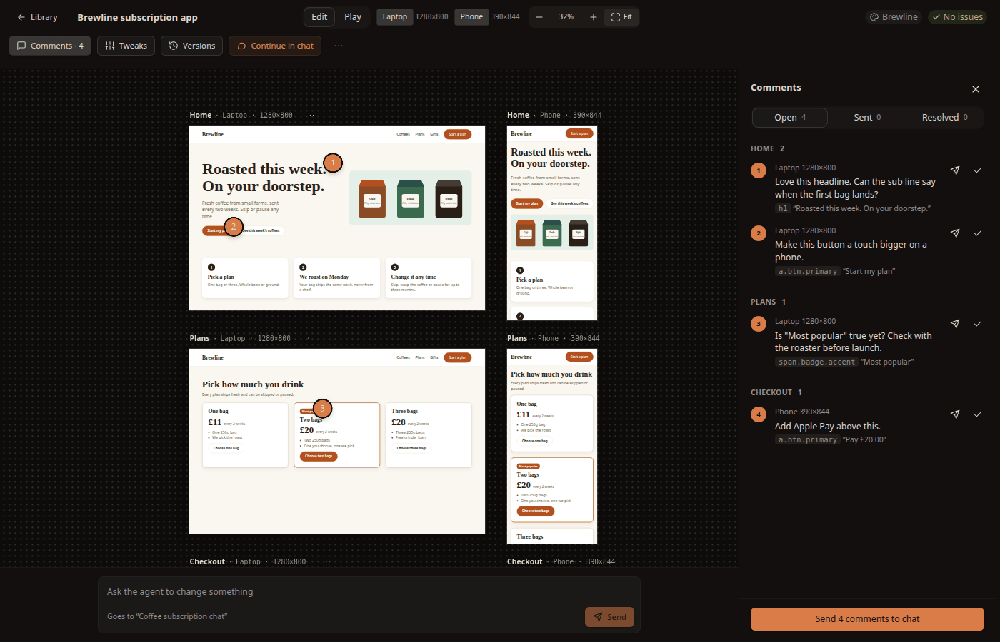

## What it is

- **Canvases.** An infinite wall where every screen of a design sits next to every device size you care about. Edit mode to comment and edit, Play mode to click through the prototype.
- **Pages.** One self-contained HTML page shown full screen, exportable as a ZIP or a single HTML file.
- **Design systems.** Tokens, type, components, notes and brand files, written by the agent, reviewed by you, and used by new designs.
- **Inside OpenChamber.** A rail panel lists your designs and a full-screen page opens them. No external browser window and no dev server. Colours follow your OpenChamber theme, light or dark.
- **Written by your own agent.** Design Chamber generates nothing. It gives your agent the design rules and a place to write, then shows the result.
- **Plain local files.** One folder per design. Open them in an editor, commit them to git, zip them.

## Install

**You need:** OpenChamber 2.7.0 or later. Linux, Windows or macOS (macOS is not in CI, see [`docs/testing/MACOS.md`](docs/testing/MACOS.md)). Optional: Chrome, Edge or Chromium, used to draw thumbnails and run checks. Without one, the library falls back to live previews and checks cannot render.

**One click:** [Install in OpenChamber](openchamber://extensions/install?url=https%3A%2F%2Fgithub.com%2FSpeak-Technologies%2Fdesign-chamber%23release). OpenChamber asks before it adds anything.

**By hand:** open **Settings → Extensions → Add from Git** and paste:

```text
https://github.com/Speak-Technologies/design-chamber#release
```

GitHub may not turn the one-click link into a button, so the line above always works. The `release` branch holds the built extension from the latest release. To stay on one version, use `#release-v0.6.0` (or the version you want). **Settings → Extensions** offers **Update** when a newer release is out.

**From source:** `npm install && npm run build`, then add the repo folder in **Settings → Extensions**. `dist/` is not committed, so build first. `npm run build && npm run pack` makes `design-chamber-<version>.zip` if you would rather install that. Each GitHub release carries one too.

After the install, OpenChamber asks you to approve permissions: sending prompts, reading sessions and running Design Chamber's local helper (the "service"). The same install adds instructions, a skill, a `design_check` tool and chat blocks so your agent knows where designs go.

## Quick start

1. **Start a canvas.** In any chat, begin a message with:
   ```text
   /design a landing page and plans screen for a coffee subscription, laptop and phone
   ```
   Your agent reads your project's design rules, may ask a few questions, then writes the files. The design appears in the panel the moment its first file lands.
2. **Or a single page:** `/page a one-page repair-cost estimator`.
3. **Or a design system:** `/design-system`. The agent interviews you, reads your code, and builds the system (see [Design systems](#design-systems)).
4. **Already have HTML in a chat?** On an assistant message with an HTML code block, open the **⋯** menu and pick **Open as page**.
5. **Go full screen.** The rail viewer is compact. For the library and the full wall, use OpenChamber's **sidebar → Extension pages → Design Chamber**. An extension cannot open its own full-screen page from code, so the rail points you there.
6. **Let the agent write to your Designs folder** without asking every time: see [Let your agent write here](#let-your-agent-write-here).

`/design` and `/page` only run when they start the message. Agents that never see them still find your designs folder through [the guide and the skill](#help-your-agent-find-your-designs).

## Features

### Browse your designs

The rail shows a compact list with search, All / Canvases / Pages tabs and a **Show** select for projects, folders and design systems. The full-screen library adds a sidebar, a System filter, sorting and tiles or a list.

| | |
|---|---|
| 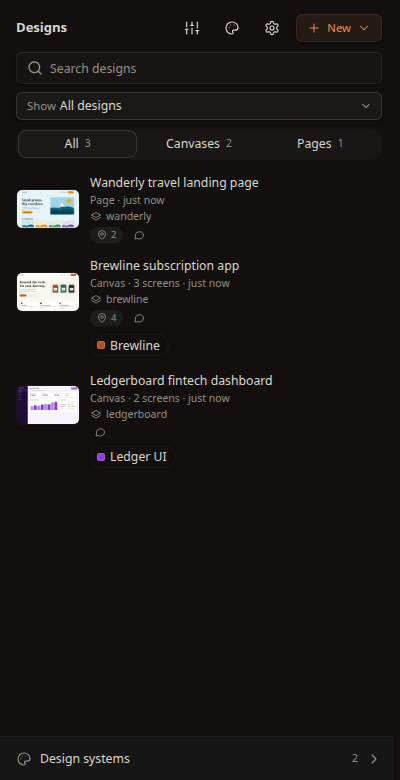 | 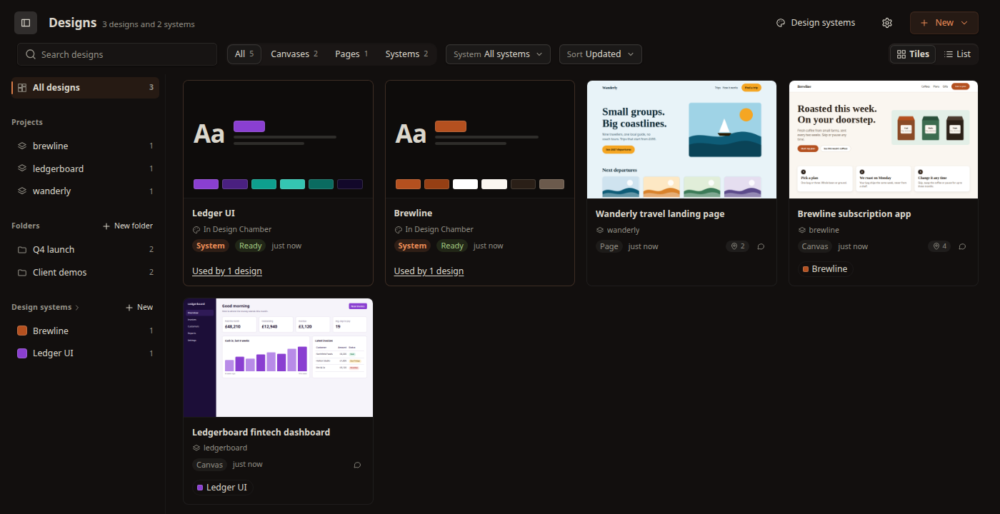 |
| **Rail.** The same designs, compact. | **Library.** Projects, folders, design systems, filters. |

**Projects and folders.** Designs group by the project folder their chat was opened in. You can also make your own folders, and a design can sit in several. Grouping never moves anything on disk: folders live in `.chamber/folders.json` in the designs folder. Deleting a folder never deletes its designs, and Undo works for an hour.

### The canvas wall

Screens are rows and device sizes are columns. The wall pans and zooms freely. **Edit** mode picks elements to comment on or change. **Play** mode lets you click through the prototype inside its artboard. In the rail the same wall fits to the panel width.

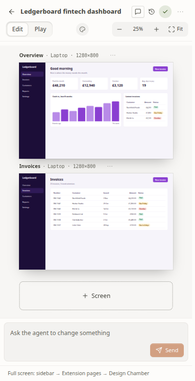

**Screens and directions.** In Edit mode, a **⋯** menu on each screen offers Duplicate, Move up, Move down, Move to trash and **Try 3 directions…**. On the full-screen page you can drag screens to reorder them. When the agent makes variations of a screen, they show as a row (Current, A, B, C) and **Keep this one** picks the winner. A canvas holds up to 40 screens. Every one of these is a hand edit: a version is saved first and Undo is offered.

### Pages and export

A page opens full screen like a browser tab, at full width or at a fixed device width.

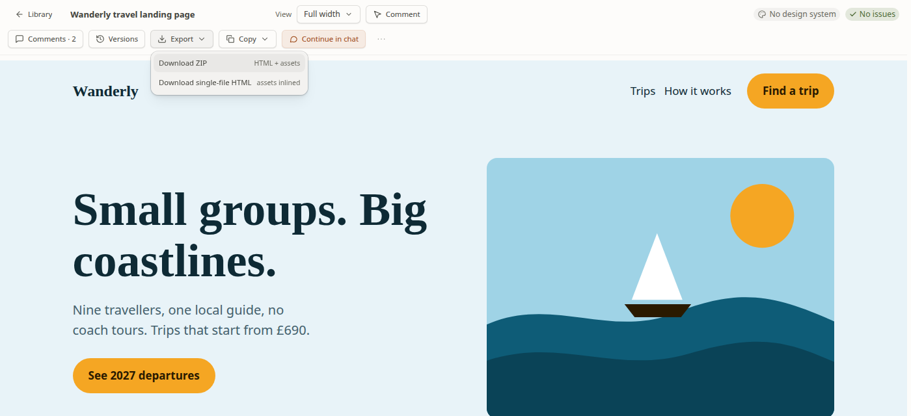

From a page, **Export** gives a ZIP (HTML and assets) or a single HTML file with assets inlined. From a canvas, the **⋯** menu offers **Export ZIP** and **Export screen as HTML…**. Files go to your Downloads folder with a **Show in folder** toast, or to `.exports/` in the designs folder if Downloads is missing. **Copy** copies the HTML.

### Comments, the ask bar and the build strip

In Edit mode, click any element, write a note, and a numbered pin lands on it. The element's selector and text travel with the comment, so it survives edits. If the element moves or disappears the pin turns dashed and is listed as detached. Pins work on pages too.

Open **Comments** to see them all. **Send N comments to chat** posts them to the design's linked chat as one revision request, or you can send one pin at a time.

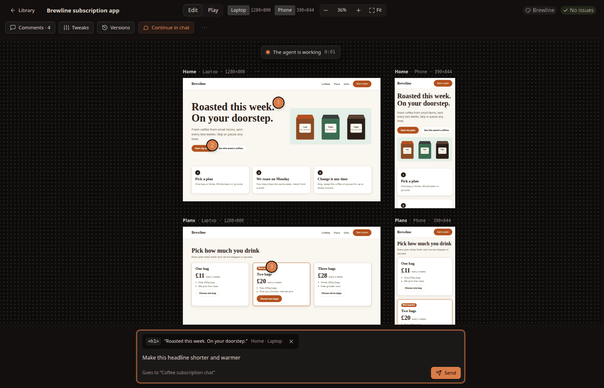

The **ask bar** under the wall sends your own words to the linked chat, optionally about one picked element. The **build strip** over the wall shows what that agent is doing: working, writing a file (the matching artboard lights up), waiting on a question, done or failed. Every design remembers its chat. **Continue in chat** reopens it, or starts a new one if the old chat is gone.

### Edit on the canvas

You can fix small things without a chat round trip. Click an element in Edit mode to get the selection toolbar: **Edit text**, **Comment** and **Ask agent**. Double-click text to edit it in place.

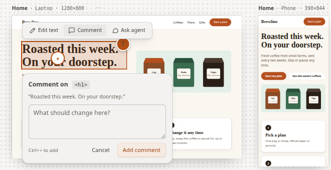

Hand edits follow the same rules everywhere. A version called "Before your edits" is saved first. Only the edited part of the file changes. If the agent or another program changed the file in the meantime, nothing is written and your text stays. Undo works for 30 minutes. The agent is told about your hand edits in the next message Design Chamber sends to its chat.

**Tweaks.** The agent can declare up to 12 knobs (a slider or a few named choices), each tied to one variable in the design's `tokens.css`. Move a knob and every screen updates live. **Save** writes only those values into `tokens.css`.

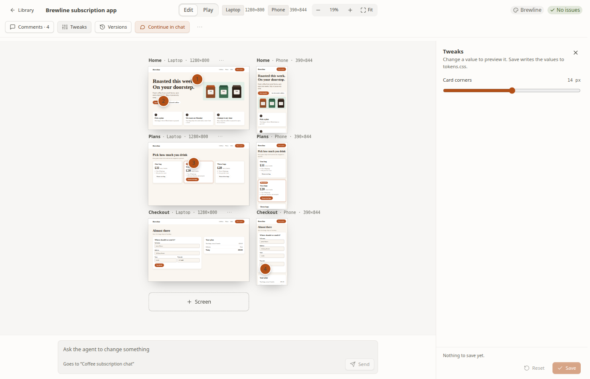

### Versions

A snapshot is saved after a quiet moment and after every agent turn on a linked design, even with no Design Chamber window open. In **Versions** you can **View** an old one, **Compare** it with the current design (every artboard splits version and current, with a list of changed files), or **Restore** it. A restore saves the current state first and offers Undo, so it is never destructive. The newest 100 versions are kept.

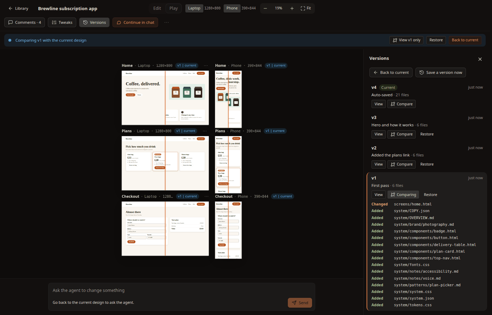

### Checks

Before an agent says a design is done, it checks it. Design Chamber renders every screen at every viewport in headless Chrome, offline, saves pictures and lists what is wrong:

- **Errors:** missing files, links to the internet, content wider than the viewport, low text contrast, images without `alt`, form fields without labels, script errors.
- **Warnings:** tokens redefined in a screen, ignored `design.json` fields, missing doctype, `lang`, viewport meta or title, cut-off text.
- **Notes:** hardcoded colours although `tokens.css` defines them, page height, no browser found.

Agents inside OpenChamber use the `design_check` tool. Every other agent runs the same check from a shell:

```sh
sh '<designs folder>/.chamber/bin/dc' check <slug>
```

(`dc.cmd` on Windows.) Options are `--screen <id>`, `--static` (files only, no browser) and `--json`. Exit code 0 means no errors, 1 means errors were found and 2 means the check could not run. The launcher needs no token and no Node on your PATH.

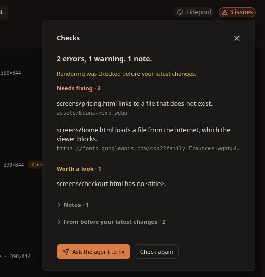

The same findings feed the **Checks badge** in the viewer. **Ask the agent to fix** sends them to the linked chat. Chat blocks and Work Status show the badge too.

### Design systems

A design system is its own item in the designs folder: colours, type, spacing, radii, shadows, components with usage notes, patterns, brand files, and an overview. Notes and overviews are written in markdown and render as markdown, tables included. A system covers four areas: Foundations, Components, Patterns and voice, and Brand and marketing.

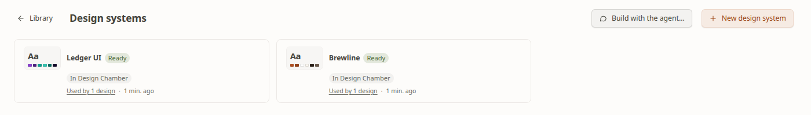

**Making one.** Type `/design-system` in a chat for an interview in two rounds: where the system lives, whether to fix the project's token code or only describe it, which areas to cover, then the calls it found in your code. The agent can "fix tokens, then document": it shows a reviewed diff first and writes the repo only after you approve it. Design Chamber itself never writes your repo. You can also start from the **New design system** sheet: from project code, from brand files, from a description, or from an existing system folder (register it as it is, or make a new one from it).

**Where it lives.** An **internal** system lives in `_systems/<id>/` in the designs folder. A **repo-backed** system lives in your project, with a generated living page (one self-contained HTML file, no scripts) that the agent commits. Repo-backed systems are read-only in Design Chamber: ask the agent to change them and it proposes a diff.

**The specimen board.** Every system gets a board that draws each component on light and dark grounds. The agent can set a layout hint per entry in `system.json`: `card` (the default), `compact` (buttons, badges), `full` (navigation, toolbars) or `table` (long lists read row by row).

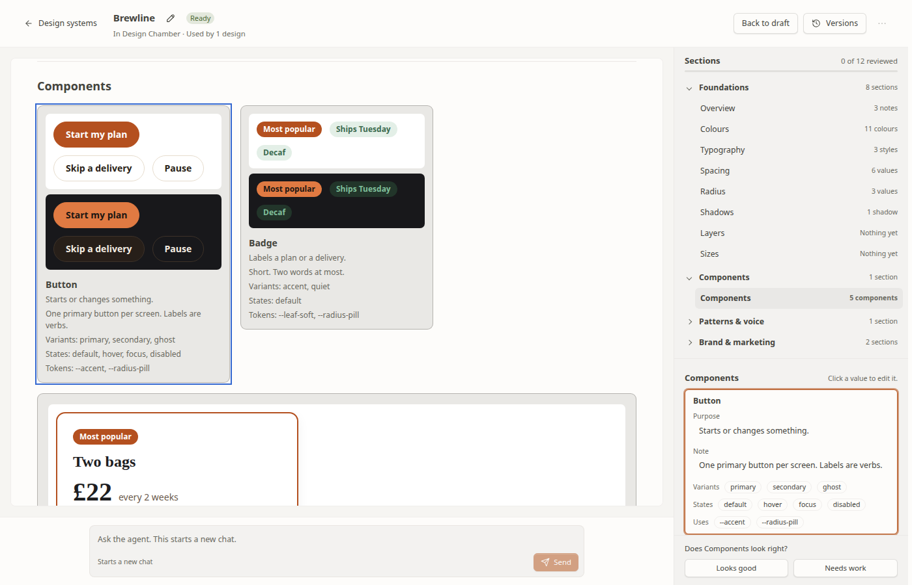

**Using one.** A new design can start from a system you pick in the New dialog, or the agent asks which one. Each design keeps its own copy, so it never changes under you. When the system changes, the design's chip offers **Review update**. Your tweaks stay as overrides on top, each with **Reset to system**. Systems can be reviewed section by section (**Looks good**, **Needs work**), edited by hand, and re-synced when the code they were read from changes.

**System checks.** `dc check --system <id>` checks a system's files and draws its board at a wide and a narrow width. The pictures are what the agent looks at before it says the system is done. It warns when a layout hint is too small for an entry, for example a `compact` entry that needed the full width.

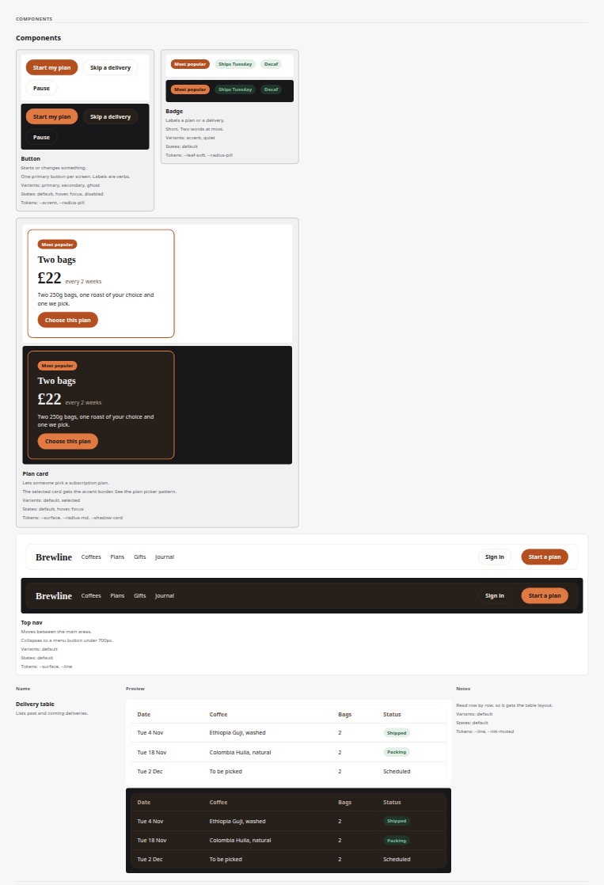

### In the chat

When an agent finishes a design it can put a **DesignCard** in its reply: a preview, the screens, the Checks badge, and **Open** and **Comment** buttons. When it wants you to choose between directions it asks with a **DirectionPick**. In a `/design-system` chat the interview and the diff to approve arrive as a **SystemAsk** block.

| | |
|---|---|
| 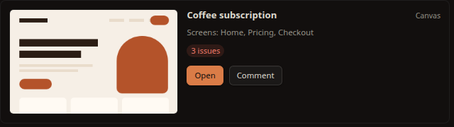 | 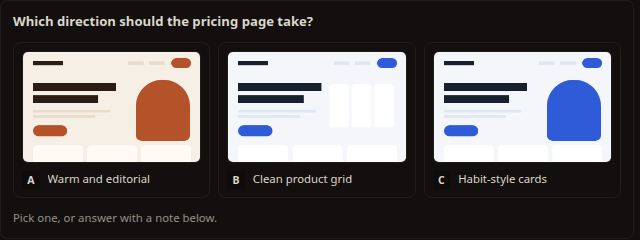 |

OpenChamber's Work Status shows recent designs, what the agent is writing and check results. Type `@` in the composer to give the agent a design's folder, its rules and its open comments.

### Help your agent find your designs

Four channels carry the same core rules, so an agent finds Design Chamber without a slash command:

1. A short note in every agent's instructions, while the extension is on.
2. The built-in `design-chamber` skill, with the full design rules and the style presets.
3. `AGENTS.md` in the designs folder, for agents that run outside OpenChamber. Design Chamber keeps it current and never overwrites one you edited.
4. A snippet you can paste into your own `AGENTS.md`.

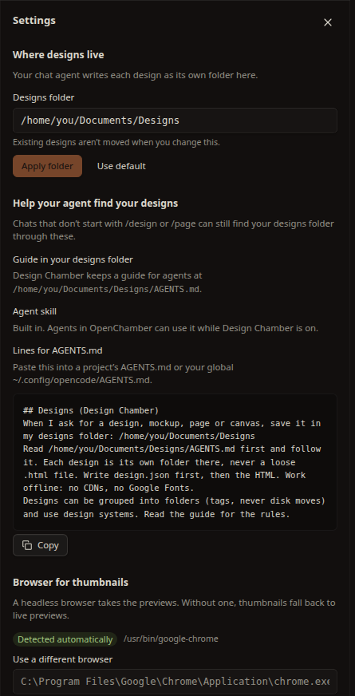

### Let your agent write here

OpenCode asks before an agent writes outside the project folder. To allow your designs folder once, add this to your `opencode.json`. **Settings → Let your agent write here** shows it with your real path and a Copy button. Design Chamber never edits your config.

```json
{
  "permission": {
    "external_directory": {
      "/home/you/Documents/Designs/**": "allow"
    }
  }
}
```

### Change the designs folder

**Settings → Designs folder → Apply folder.** Existing designs are not moved. Earlier folders are listed with **Switch back**, and **Use default** returns to `~/Documents/Designs`.

### Write a good brief

Say what it is, who it is for, the main task, the tone and the screens you want, plus anything real you have (copy, a logo, photos). One or two sentences is fine, up to 2,000 characters. For anything open-ended the agent sends one message with 3 to 6 questions, each with a recommended default. Reply with changes, or say **go**. Put "go" in your brief to skip the questions.

The agent reads your project first: `DESIGN.md`, token and theme files, and the design sections of `AGENTS.md` or `CLAUDE.md`. Rules apply in this order, highest first:

1. What you say in chat.
2. Your project's design rules.
3. The style preset you picked.
4. This design's own `DESIGN.md` and `tokens.css`, once you confirm them.
5. The built-in rules against a generic look.

When a design is linked to a design system, the order is your words, then the system, then your project's files for whatever the system does not cover, then the built-in rules. The preset picker is hidden while a system is chosen.

Viewports come from your project's breakpoints when it has them, otherwise Laptop 1280×800 and Phone 390×844. Presets: `editorial`, `minimal-saas`, `brutalist`, `warm-craft`, `data-dense-dashboard`, `playful`, `luxury`, `technical-mono`, `poster-print` and `nocturne`.

## Keyboard shortcuts on the wall

| Key | Action |
|---|---|
| Wheel or trackpad over the background | Pan |
| `Space` and drag, middle-drag, `H` | Pan tool (`H` toggles it) |
| Arrow keys | Nudge the view |
| `Ctrl` or `⌘` and wheel, pinch | Zoom around the cursor (5 to 400 %) |
| `+` and `-` | Zoom in and out |
| `Shift+0` | 100 % |
| `Shift+1` | Fit all |
| Double-click an artboard label | Focus that artboard |
| Click an element (Edit) | Open the selection toolbar and comment box |
| `Ctrl` or `⌘` and `Enter`, `Esc` | Add the comment, cancel and close popovers |

## On disk

```text
<designs folder>/                  ~/Documents/Designs by default
├── AGENTS.md                      guide for agents, kept by Design Chamber
├── <slug>/                        one folder per design (lowercase letters, digits, hyphens)
│   ├── design.json                kind ("page" or "canvas"), title, dates, linked chat,
│   │                              viewports, screens, tweaks, comments
│   ├── index.html                 a page's entry file
│   ├── screens/<id>.html          a canvas's screens, one file each
│   ├── assets/                    images, fonts, CSS and scripts, by relative path
│   ├── DESIGN.md, tokens.css      this design's design system, in words and as variables
│   ├── system/                    the design's own copy of its design system
│   ├── .versions/                 snapshots, newest 100 kept
│   └── .chamber/                  Design Chamber's own state: check report and pictures,
│                                  undo records, saved page data, the agent's RULES.md
├── _systems/<id>/                 a design system (never listed as a design)
│   ├── system.json, tokens.css    structured part and token values
│   ├── OVERVIEW.md                what the system is for
│   ├── notes/, patterns/, brand/  markdown, rendered on the board
│   ├── components/<id>.html       one example per component
│   └── assets/, .versions/, .chamber/
├── .chamber/                      folders.json and the check launcher (bin/dc, bin/dc.cmd)
├── .trash/                        deleted designs and systems, never hard-deleted
└── .exports/                      export fallback when there is no Downloads folder
```

A folder counts as a design when it holds `design.json`, `.chamber/state.json`, an `index.html` or a `screens/` folder. Any other folder is yours and is left alone. Loose `.html` files in the root are offered for import as pages. Fonts go in `assets/`: designs cannot load Google Fonts or CDNs. The exact schema is in [`docs/SPEC.md`](docs/SPEC.md) §6.

## Privacy and security

- The service listens on **127.0.0.1 only** and needs a **bearer token** on every request. Panels and designs never see the token.
- **Agent-written HTML is untrusted.** It renders only in sandboxed iframes with a content security policy, and never with `allow-scripts` and `allow-same-origin` together. A design cannot reach the host, the service or the token.
- **Designs get no network.** Remote scripts, web fonts and remote images are blocked. A banner says what was blocked and offers **Ask the agent to fix it**. Local files and inline scripts work.
- Every path is resolved and checked to stay **inside the designs folder** before it is read or written.
- Nothing leaves your machine except what your chat model sees: your brief, the comments you send, and the files your agent reads. Checks render offline.
- Design Chamber never edits your OpenCode or OpenChamber config. Outside the designs folder it writes its own settings folder, exports to your Downloads folder when you export, and, only when you click **Remove old copy** in Settings, deletes an old `design-chamber` skill copy that an earlier version installed.
- It starts a headless Chrome, Edge or Chromium for thumbnails and checks, and uses your system's file manager for **Show in folder**.

## Troubleshooting

| Symptom | Fix |
|---|---|
| Cards show a live preview instead of a PNG thumbnail | No Chrome, Edge or Chromium was found. **Settings → Browser for thumbnails → Use a different browser**, paste the path, then **Test and save**. |
| The agent asks permission every time it writes a file | Add the `external_directory` snippet from [Let your agent write here](#let-your-agent-write-here) to your `opencode.json`. |
| An artboard says a screen "isn't written yet" | `design.json` lists a screen the agent has not written, or has misnamed. It appears the moment the file lands. If not, ask the agent to finish or fix it. |
| A design looks unstyled, or a banner says it loads files from the internet | The page references a CDN, web font or remote image, which is blocked by design. Ask the agent to inline the CSS and put fonts and images in `assets/` with relative paths. |
| My designs vanished | The designs folder was changed. **Settings → Earlier folders → Switch back.** |
| A folder I made by hand is not listed | It needs `design.json`, an `index.html` or a `screens/` folder, and a name of lowercase letters, digits and hyphens that starts with a letter or digit. Hidden folders are ignored. Loose `.html` files in the root get an import banner instead. |
| The agent says the check could not run | Open the Design Chamber panel once so it can record where OpenChamber's runtime is, then try again. Where `design_check` is not available (a remote OpenCode, a terminal agent), run the `dc` command from `AGENTS.md` in the designs folder. |
| Nothing happens after `/design` | Check that the extension's permissions were approved and that OpenChamber is 2.7.0 or later, in **Settings → Extensions**. `/design` only runs at the very start of a message. |

More known limits are in [`documentation/known-issues.md`](documentation/known-issues.md).

## Development

```bash
npm install
npm run build        # dist/: panel and page, background, status, blocks (IIFE), service and CLI (Node ESM), plugin, skills
npm run typecheck    # tsc --noEmit, strict
npm test             # node:test, Node 22.18 or later
npm run check        # typecheck, build and test: all three pass before a change is done
npm run guest-check  # OpenChamber's own package checker on the built extension (build first)
npm run pack         # release zip, design-chamber-<version>.zip (build first)
```

There is no dev server by design: rebuild with `npm run build` and reload the extension.

To look at the built UI, `node test/ui/visual/shoot.mjs <filter> --out <folder>` runs it behind a mock OpenChamber host and an in-memory fake service in headless Chrome, at rail widths and full-screen, in light and dark. Always pass `--out`; the default writes into tracked docs. The pictures in this README come from `test/ui/visual/scenarios/readme-shots.mjs`, which points the same UI at the real built service on a scratch designs folder of fake projects.

Where to read more:

- Product decisions: [`docs/BRIEF.md`](docs/BRIEF.md). Technical spec and layout: [`docs/SPEC.md`](docs/SPEC.md) (§12 is the repository layout).
- Plain-English docs for every page and feature: [`documentation/`](documentation/README.md).
- Agent-facing design rules and presets: [`rules/`](rules/README.md).
- Working agreements: [`AGENTS.md`](AGENTS.md).

### The agent team

This repo is built by a small team of AI agents with one human owner. [`AGENTS.md`](AGENTS.md) and [`.agents/rules/claude-agent-protocol.md`](.agents/rules/claude-agent-protocol.md) say how they work. The main session leads, dispatches specialists, and reports with evidence. Pushing, opening or merging PRs and publishing stay with the owner.

[`.agents/team.json`](.agents/team.json) is the source for `AGENTS.md` and for the agent files in `.claude/agents/` and `.opencode/agents/`. After editing it, re-render those files and run `node .agents/verify-team.js`. The script currently exits 1 on two known false positives, which are curly-brace sets in dated specs that it reads as unfilled placeholders: `documentation/specs/agent-guidance-and-pages.md` (`{API,DOCUMENTATION}`) and `documentation/specs/phase-2-technical.md` (task lists such as `{T1, T2a, T7a}`). Any other failure is real. The roster:

| Agent | Role |
|---|---|
| product-specialist | Requirement specs for features and flows. No code. |
| architect | Technical designs and threat models. No production code. |
| backend-developer | The local service, shared types, the guest core, the `dc` command and the OpenCode plugin, and their tests. |
| ui-ux-developer | The panel, page, wall, blocks and design-system screens, plus the visual harness scenarios. |
| qa-tester | Verification after every implementation, regression tests, minor issues in `known-issues.md`. Never fixes production code. |
| browser-tester | The second QA step for UI changes. Walks the flow in the visual harness or a folder-installed OpenChamber, always on a scratch designs folder, rail and full-screen, dark and light. Never fixes code. |
| code-reviewer | Independent review of a diff, on request. |

`openchamber-design-canvas` (an earlier project by the same owner) is where some ideas came from: Chrome discovery, pan and zoom math, prompt rules and presets. Design Chamber is a different design: it renders in-app and needs no external window or dev server.

## Licence

MIT. See [`LICENSE`](LICENSE).
